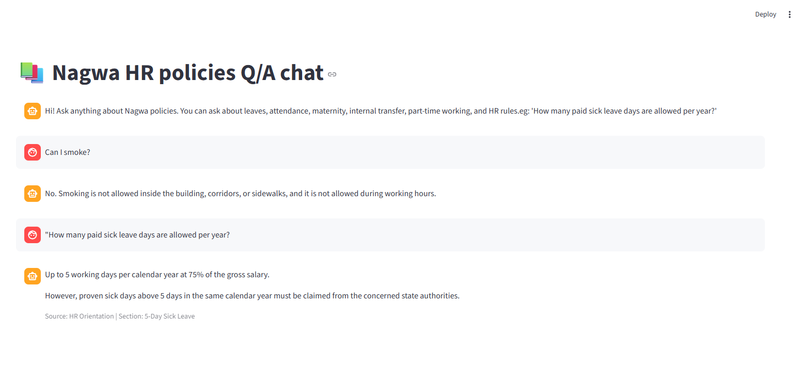

# Nagwa HR Policies System

RAG-based Q&A assistant for Nagwa HR policies. Employees ask questions in natural language; the system retrieves relevant policy chunks and answers using an LLM via OpenRouter.

## Features

- Streamlit chat UI with follow-up question handling
- Hybrid retrieval: BM25 + FAISS dense embeddings + cross-encoder reranking
- FastAPI endpoint for programmatic access
- Optional RAG evaluation scripts

## Project structure

```text
├── src/
│   ├── chat_ui.py        # Streamlit chat app
│   ├── main.py           # FastAPI `/ask` API
│   ├── retriever.py      # Hybrid retrieval + reranking
│   ├── llm.py            # OpenRouter answer generation
│   ├── chunking.py       # PDF → chunks
│   ├── build_index.py    # Build FAISS + BM25 indexes
│   ├── evaluate_rag.py   # Offline evaluation
│   └── llm_evaluator.py  # LLM-as-judge scoring
├── data/                 # Local only (gitignored)
│   ├── hr_policies/      # Source PDF policies
│   ├── chunks.json
│   ├── metadata.json
│   ├── faiss_index.bin
│   └── bm25.pkl
├── Dockerfile
└── requirements.txt
```

> **Note:** The `data/` folder is not tracked in Git. Keep policy PDFs and indexes locally.

## Requirements

- Python 3.11+ (Docker image uses 3.11)
- OpenRouter API key
- Local `data/` with indexes (or rebuild them from PDFs)

## Setup

```bash
git clone https://github.com/miroz1990/nagwa-hr-policies-system.git
cd nagwa-hr-policies-system

python -m venv .venv
source .venv/bin/activate   # Windows: .venv\Scripts\activate
pip install -r requirements.txt
```

Create a `.env` file in the project root:

```bash
OPENROUTER_API_KEY=your-key-here
```

Export it before running (the app reads the env var; it does not auto-load `.env` yet):

```bash
export OPENROUTER_API_KEY="your-key-here"
```

### Prepare data (local)

1. Place HR policy PDFs in `data/hr_policies/`.
2. Build chunks (if needed) with `src/chunking.py`.
3. Build indexes:

```bash
cd src
python build_index.py
```

This creates `faiss_index.bin`, `metadata.json`, and `bm25.pkl` under `data/`.

## Run

### Streamlit chat (main app)

```bash
source .venv/bin/activate
export OPENROUTER_API_KEY="your-key-here"
streamlit run src/chat_ui.py
```

Open http://localhost:8501


## Chat UI

The Nagwa HR Policies Q/A Chat provides a conversational interface for querying HR policies and retrieving relevant policy information.



### FastAPI

```bash
cd src
uvicorn main:app --reload
```

`POST /ask` with body:

```json
{ "query": "How many paid sick leave days are allowed per year?" }
```

### Docker

```bash
docker build -t nagwa-hr .
docker run -p 8501:8501 -e OPENROUTER_API_KEY="your-key" nagwa-hr
```

## How it works

1. **Retrieve** — hybrid BM25 + dense search over policy chunks, then cross-encoder rerank.
2. **Generate** — send retrieved context + question to OpenRouter (`meta-llama/llama-3.1-8b-instruct`).
3. **Answer** — grounded in retrieved policy text only; otherwise returns `Not mentioned in policy.`

## Evaluation

```bash
cd src
python evaluate_rag.py
```

Uses questions in `data/evaluation_questions.json` (local).

## Security notes

- Never commit `.env` or API keys.
- `data/` (policies and indexes) is gitignored and should stay private.
